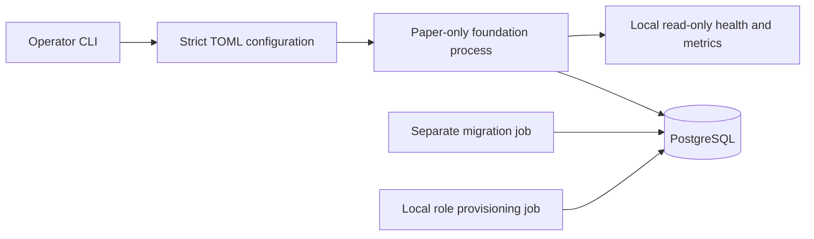

# Approved architecture and Phase 1 decisions

Baseline: the user-approved specification of 17 October 2026. Its economic conclusion
is **research and paper first; no live trading now**. Phases 1–3 are merged; the user authorised Phase 4. Each milestone retains
its own recorded implementation and validation boundary.

The [Phase 4 offline paper core](phase-4.md) adds ADRs A27–A29, immutable paper
contracts, a GBP ledger, flow-neutral units, independent admission/dispatch checks,
single-writer durable commands, a separate simulated venue and recovery. Runtime
database privileges remain SELECT/INSERT. No continuous runner or live writer is
included; historical milestone descriptions below retain their original scope.

[A30 — protected financial audit prefixes](phase-4-financial-prefix.md) adds an
operator-owned audit attestation with runtime SELECT only. It binds reuse to exact
installed code/policy and retained SQL anchors; full suffix/journal validation
remains. Ordinary runtime checkpoints cannot create this authority. No pruning,
historical-aggregate certificate or trading activation is granted.

[A31 — bounded paper history](phase-4-bounded-history.md) adds separately authorised,
lossless PostgreSQL compaction and protected historical economic summaries. Online
readers require the explicit current certificate and validate every new suffix
record; full audits reconstruct original history. Runtime cannot create certificates
or remove rows. The supported suffix and stopped-worker maintenance requirements
are explicit. The [paper handoff](phase-4-paper-release.md) records current acceptance
and the separate research, deployment and live boundaries.

## System boundary

One Python modular monolith, PostgreSQL operational authority, GBP reporting, BTC/GBP
and ETH/GBP initially. Domain and future strategy code cannot depend on venue symbols.
Public Kraken adapters and historical research are implemented. Reconciliation,
financial journals and paper/live execution remain later milestones.

The default foundation service is offline. Only the opt-in public collector and
local archive acquisition have public transports. There are no exchange credential
fields, Discord client, order submission method, trading command, activation flag
or live Compose profile. The
Compose application network is internal and has no published ports. A health result
cannot activate trading. The provisional policy is configuration, not a risk engine.

## Decision log

| ADR | Decision and rationale |
| --- | --- |
| A01 | Modular monolith: two slow instruments do not justify microservices. |
| A02 | Bounded bespoke core; future trading safety must be established by tests. |
| A03 | Future Kraken commands through one REST path; v2 streams supply data/events. |
| A04 | PostgreSQL rather than SQLite or Redis for durable operational state. |
| A05 | Future execution has one writer per account; PostgreSQL locks are not exchange fencing. |
| A06 | Decimal(precision 50) calculations, exact NUMERIC(38,18) storage boundaries, UTC timestamps. |
| A07 | Future inbox/outbox is transactional PostgreSQL state, not a distributed broker. |
| A08 | Future exchange-held stop limits; global cancellation timer disabled because it removes exits. |
| A09 | GBP execution first; USD/USDC conversion execution deferred. |
| A10 | CLI and local health/metrics before a dashboard. |
| A11 | Free official historical sources first; no paid data provisioned. |
| A12 | Personal/proprietary capital only; external investor activity is outside scope. |
| A13 | Package migrations inside `aca.storage` so a built wheel can migrate outside the checkout. |
| A14 | Research dependencies are deferred, rather than creating an untested research lock in Phase 1. |
| A15 | Explicit settings sources: TOML plus only ACA_CONFIG/ACA_MODE; implicit dotenv/secrets/env precedence disabled. |
| A16 | Constrain platformdirs to the tested 4.13.3 after a failed 4.13.4 simple-index download; include hashed pip/setuptools explicitly in the development lock. Direct candidate versions are unchanged. |
| A17 | Remove pip and ensurepip after installing the runtime wheel. An immutable application image needs no package installer; pip's bundled dependencies produced four high-severity image findings outside the runtime lock. Keep installation tools in the build/development environment. |
| A18 | Use the official CPython 3.14.8 Alpine 3.24 image, pinned by digest, to remove the affected Debian runtime components. Python and direct dependency versions remain unchanged. Require hash-checked musllinux wheels and the complete Linux test suite; a missing compatible wheel or failed test blocks adoption. Development tools remain in a separate test stage. Research compatibility is deferred to its own milestone. |
| A19 | Derive PostgreSQL from the official 18.6 Alpine 3.24 image, pinned by digest, and remove unused gosu because the entrypoint starts as postgres. Scan both runtime images. Move existing local data by verified logical backup/restore into a separate volume; never mount a glibc cluster directly into musl. Keep the original volume for rollback. |
| A20 | Verify the built application wheel instead of an editable install. Clean Linux testing exposed an unlocked editable-install helper. Installing the packaged wheel also validates packaged migrations without adding a new dependency. |

**A16 amendment, 20 October 2026:** constrain the shared transitive certificate
bundle to `certifi==2026.10.19` following
[GHSA-6q48-6c7w-9gw2](https://github.com/certifi/python-certifi/security/advisories/GHSA-6q48-6c7w-9gw2).
Regenerate only that package's pin/hashes in the runtime, development and research
locks, inspect the upstream wheel, and rerun advisory, clean Linux and container
checks. Do not ignore the advisory or disable TLS verification. This changes no
direct dependency candidate, database schema or running deployment.

**A16 amendment, 24 October 2026:** constrain the development transitive build
tool to `setuptools==84.1.0` following
[GHSA-xmj3-9gf7-h52w](https://github.com/pypa/setuptools/security/advisories/GHSA-xmj3-9gf7-h52w).
Verify the upstream wheel/sdist SHA-256, Python compatibility and MIT licence,
replace only that package's development-lock entry, and require hash-checked
installation, dependency audits, packaging and release regression. The patch
validates legacy wheel namespace-installation paths; no audit suppression is
introduced. Runtime/research locks, direct dependencies, base images, financial
policy and retained services are unchanged.

**A19 amendment, 24 October 2026:** later CI reached the database image scan and
found CVE-2026-111497 in `brotli-libs==1.2.0-r1`. Keep the reviewed PostgreSQL
18.6/Alpine base digest and add the exact signed Alpine package
`brotli-libs=1.2.1-r0` during the image build. Do not use a general `apk upgrade`;
the verified build changes only that package. The
[upstream security release](https://github.com/google/brotli/releases/tag/v1.2.1)
contains the decoder fix. Require current image scans and PostgreSQL regression.
This source-image update does not migrate or restart retained databases; PostgreSQL
version, schema, filesystem permissions and the non-root service user are unchanged.

No direct dependency candidate substitution was required. Version/digest observations and
verification limits are recorded in the milestone report. Changes to these decisions
must be reviewed rather than inferred from a successful health check.

## Durable records

`aca.configuration_versions`: content hash, version, paper mode, non-secret document,
UTC creation timestamp. `aca.audit_events`: UUID, run correlation UUID, UTC timestamp,
actor, event, configuration reference and redacted detail. Configuration is inserted
once per hash; each process startup/shutdown appends a separate audit event.

Both tables reject UPDATE, DELETE and TRUNCATE through database triggers. Runtime has
SELECT/INSERT only. Corrections will be additional events, not edits. The migrator
owns the schema; it is not mounted into runtime as a credential. The administrative
credential exists only in the database and explicit provisioning job.

History is append-only against ordinary runtime/owner operations, **not tamper-proof
against a database administrator**. Backup separation and institutional governance
remain future work. No financial ledger or tax reconstruction claim is made yet.

## Future risk semantics retained

The fixed v1 limits are 5% soft drawdown, 10% hard drawdown, 2% UTC daily loss,
0.5% planned risk per position episode, 30% total exposure, 15% per asset, 1% aggregate
planned risk, two positions, zero leverage, no pyramiding and no automatic hard-halt reset.
Cash-flow unitisation must precede return/drawdown enforcement. Contributions cannot
clear a halt or become profit. Stops do not guarantee fills or a maximum loss.

Every later milestone must preserve unknown submission outcomes, avoid retries of
ambiguous commands, count uncertain buys as exposure, reconcile private events to
authoritative financial records and preserve protective exits during halts.

## A21 — opt-in public capture boundary (Phase 2)

Add HTTPX 0.28.1 and websockets 17.2 from the planned candidates, with reviewed
transitives in both hash locks. Expose public discovery/history/stream protocols;
provide no account or execution protocol implementation in this release. A separate
Compose profile gives only the public collector egress. Default bootstrap remains
offline. Capture is a supervised local evidence process, not an execution owner.
Its PostgreSQL session advisory lock prevents duplicate capture against one database.

## A22 — public timestamp evidence and deduplication

A live public trial found a one-microsecond difference between REST epoch-decimal
and WebSocket RFC3339 times for the same public trade ID, with exact matching price,
quantity and side. The Kraken application binding supplies a narrowly scoped
cross-protocol timestamp comparator: at most one microsecond, those two public
sources, Kraken only. Default storage remains strict. Record every accepted alignment
in a separate append-only receipt linking both sources; never overwrite canonical
trade economics or source evidence. Same-protocol changes, larger differences and
any economic mismatch fail. This says nothing about private fill identity or financial
posting authority, which must be independently established in later milestones.

## A23 — bounded local capture and conservative gaps

Store public evidence and deduplicated trades in PostgreSQL for this low-volume
milestone, with a 2GB database budget and bounded protocol buffers/pages. Require
manual archival/review before exceeding it; do not weaken append-only controls to
prune data. Startup, disconnects and unsafe data establish explicit gaps. Recent REST
recovery never proves complete history. Local candles qualify only for closed intervals
within healthy continuous capture segments; unexplained empty intervals remain absent.
Long-term retention, archive ingestion and production disk management are later work.

## A24 — bounded local research dependencies (Phase 3)

Add only the planned NumPy 2.5.4 in a separate hash lock. Standard-library CSV,
JSON, ZIP and hashlib handle this small four-series study. Pandas, SciPy, PyArrow
and DuckDB add no required behaviour here and remain deferred; no substitution of
an unverified version is implied. Statistical NumPy floats never feed executable
quantities or financial postings. The runtime image excludes NumPy; CI's test
image installs the research lock and verifies its CPython 3.14 musllinux wheel.

## A25 — evidence levels and incomplete windows

A bounded HTTP range reader selects four members from Kraken's concatenated ZIP
parts, checks exact ranges and strong ETags, and lets zipfile verify member CRCs.
This is explicitly weaker than verifying the published full-archive SHA-256. Support
a complete locally reassembled archive for that check. Retain raw CSVs and the
archive's manifest. Preserve a documentation/manifest coverage conflict as unresolved.
Round only excess volume precision down to 18 places, record that transform and
retain the exact original bytes; never silently round historical prices.

Treat all missing intervals as unexplained until separately reviewed. Do not fill
them or select a convenient contiguous start after seeing strategy results. Attempt
every predeclared calendar fold; record affected folds as incomplete, and suppress
selection inference from successful subsets. Current metadata/fees are explicitly
reconstructed assumptions. No actual historical rule/fee proof is inferred.

## A26 — research timing, cost and holdout boundary

Use shared pure Decimal features, signals and sizing with no venue imports in
strategies. The bar reference uses a full-bar signal lag, fresh signal evaluation,
taker fees, adverse price rounding and participation caps. A stop trigger cannot
fill until a subsequent observed open permits its limit. This is a conservative
assumption set, not a calibrated paper exchange or a claim about intrabar paths.
This original model remains `legacy-flat-window-bar-taker-v2`, a named stress,
including its conflation of two-second approval expiry and matching delay.

Amendment, 25 October 2026 (P4A-04, before corrected-model adoption):
`slow-v2` signals have a fixed deadline 60 seconds after close + 10-second
finalisation. Late evaluation cannot renew that deadline. Admission binds a fresh
two-second, state-specific risk approval; dispatch at equality is denied. The
five-second command transmission deadline is separate. Once dispatched, the
consumed command retains its ID while matching waits 250 ms–60 s. A delayed match
does not retroactively expire its approval. Modelled IOC/FOK matching must occur
before the fixed 60-second order deadline; delayed/no-observation nonexecution
is reported separately from pre-dispatch expiry. Legacy `slow-v1` records keep
their original interpretation. Paper restarts still recover before dispatch.

`ordered-trade-taker-v1` is the corrected research execution model. A closed
indicator prefix can publish a signal at finalisation; only subsequently received
individual trades supply executable price/quantity evidence. A disclosed adverse
price proxy and at most 1% of that print's quantity bound taker fills; this is
neither reconstructed order-book depth nor maker evidence. No full-bar future
volume supplies an earlier decision/fill. Stops trigger from an admissible bid
proxy, wait matching latency, and can fill only on a later event at the limit or
better. Gaps leave protected residuals. The model shares the GBP journal, sizing,
portfolio policy and independent commitment veto with paper, with explicit market
evidence differences. All-observation drawdown includes inception; daily statistics
retain daily sampling. Actual studies require the later account/calendar/data/
statistics gates, and cannot silently switch from the legacy runner.

Amendment, 25 October 2026 (Batch C, before adoption): corrected evaluation uses
one continuous account over contiguous out-of-sample report windows; training and
validation use separate accounts. Windows never liquidate, reissue capital or
clear risk. Explicit reviewed epoch inputs preserve daily suspensions and inception
high-water marks. Month-end flows occur at the next UTC month's boundary and must
have a valid pre-flow valuation; missing evidence makes the comparison incomplete.
All comparators receive identical investor flows. Passive budgets buy once per
opening/contribution, after latency, without chasing an unfilled residual or
selling to rebalance; market drift is reported. Full exposure and the 50/50
buy-and-hold blend intentionally have different mandates from risk-limited trading.
Past-exposure/risk matching is diagnostic, uses only prior observations and is
bounded to monthly buy-only adjustments; intended and achieved exposure differ.
The common calendar starts after 200 daily warm-up observations for both assets,
uses 24/6/6-month rolling segments and includes the final pre-holdout partial test
window. The holdout remains 2025-10-01 to 2026-10-01, end exclusive. Offline source
and cost reviews may finish with a named blocked/no-go decision. Local hashes,
public propagation delay and model assumptions cannot become full-archive proof,
order latency calibration, maker evidence or historical account fees.

Original A26 coordination (superseded by Batch D below): freeze the complete
20-trial family before loading data for experiments. Ordinary
runs reserve the last 12 months. A separate freeze binds report/dataset/code/cost
hashes and a review reason; holdout opening is exclusive in the dataset's local
artefact tree, and a crash does not reopen it. This is trusted local research
coordination, not a security boundary against an operator deleting/copying files.
Append-only PostgreSQL publication preserves events/artifacts independently. No
research output, freeze or statistical/economic gate can activate execution.

**A26 amendment, Phase 4a Batch D, before corrected inference:** retain the
paired circular-block percentile Bonferroni method as the baseline decision
method. Reserve all 26 definitions × two mandatory comparisons × both 7-/30-day
sensitivities (104 claims); diagnostic capital cases cannot select another winner.
Use 262,144 deterministic draws, allocating .04 family error to the
bootstrap tail and .01 to a conservative simultaneous Monte Carlo rank margin,
with synthetic null/known-effect calibration recorded before actual inference. Historical reuse remains exploratory and requires an explicit review;
resampling cannot manufacture an independent sample. Do not switch to a joint or
studentised method after results. Freeze requires typed, rechecked complete
source/code/strategy/cost/policy/calendar/inference/economic evidence. PostgreSQL
owns the one-time fixed holdout claim, independent of local folders, candidate or
dataset revision. A committed claim survives failure; no automatic retry opens it
again. Synthetic workflows have a separate namespace and cannot qualify actual
paper. Existing legacy reports remain readable but cannot authorise new freezes.

**A19 amendment, 26 October 2026:** PR #34's database-image scan reports
[CVE-2026-92392](https://curl.se/docs/CVE-2026-92392.html) in
`libcurl==8.22.0-r0`. The upstream advisory fixes the HTTP/2 upload use-after-free
in curl 8.23.0. Keep the PostgreSQL 18.6/Alpine base digest and existing Brotli
pin; install the exact signed Alpine update `libcurl=8.23.0-r0`. A refreshed
signed-index simulation changes only that package, with no additional packages.
Do not suppress the finding, disable scanning, run a general OS upgrade or alter
Python locks. Require PostgreSQL regression and fresh image scans. This source
image change does not upgrade or restart the retained database/container.

**A26 amendment, 28 October 2026 (Batch E, before new evaluation):** preregister
exactly four daily lower-turnover definitions (SMA200 1% band and two-close
confirmation on BTC/ETH) and two deterministic portfolios pairing the same rules.
Keep all 20 S0 definitions, original report/no-run identities and adaptive history
reuse within the 26-definition/104-claim budget. Use one shared cash/asset journal,
unitisation, policy epoch, risk reservations and serial simulator for each joint
portfolio. Daily signal ties use BTC then ETH; received prints retain source order.
Use per-instrument command/episode IDs and cancel only the exiting instrument's
protection. All entry and execution checks inspect the same shared portfolio.
Mandatory joint passive10 uses 5% BTC/5% ETH, with identical investor flows.
Inference uses the joint account's unit-price series. Neighbouring parameters and
cost stresses remain diagnostic/unrun until separately reviewed; no alternative
winner or optimised weight is admitted. Source evidence can end all six actual
tasks before performance with an explicit no-run result. Research-only definitions
do not expand existing operational paper selections or open observation/holdout.

**A31 amendment, 29 October 2026 (P4A-15/P4A-16):** separate approved study
records from operational-only selections. Start rechecks corrected eligibility,
exact freeze/retained holdout use and explicit outcome acceptance, account,
release/source, policy, costs, operating review and an unrepeatable approval ID.
Synthetic namespaces never earn real paper credit. Persist bounded health blocks,
conservative restart gaps, external-outage evidence and signal-driven completion;
none can activate live execution or automatically pass G4.

Keep the default 2 GB database budget. The explicit `observation-8gb` setting is
a bounded capacity profile, justified by measured storage and maintenance results
in [Batch F](phase-4a-paper-readiness.md); it changes no financial/risk limit,
4,096-record suffix, 100,000-block catalogue or archive-file ceiling. Actual
producer rate/size/growth fit must be reviewed before an actual study. A physical
limit is never a promise that an arbitrary public stream fits 56 days.

Explicit stopped-worker maintenance may extend an exact immutable verified
history certificate by auditing the complete new suffix. Retain predecessor
identities and original rows; code/environment/policy changes cannot reuse it.
Pin a fully verified certificate only to the execution owner's dedicated locked
connection, clearing it on owner loss/release. Runtime cannot alter its prefix;
separate reports/rebuilds still verify independently. After the read snapshots
close, ordinary stopped-worker VACUUM/ANALYZE makes dead-row space reusable without
deleting logical history. Charge maintenance/restart time to availability. The
measured profile is conditional engineering evidence, not an observation start,
actual elapsed reliability, off-host backup or live approval.
