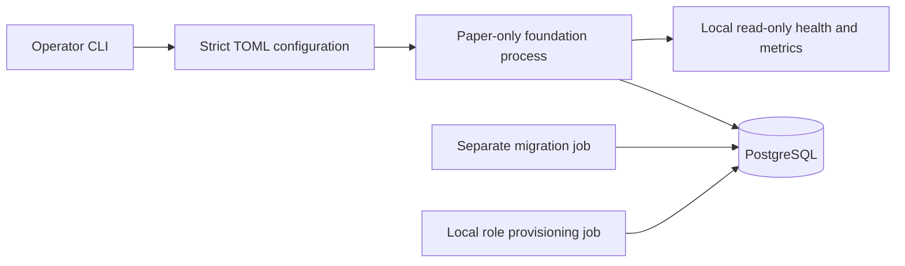

# Approved architecture and Phase 1 decisions

Baseline: the user-approved specification of 17 October 2026. Its economic conclusion
is **research and paper first; no live trading now**. This repository implements only
the explicitly approved Phase 1 boundary.

## System boundary

One Python modular monolith, PostgreSQL operational authority, GBP reporting, BTC/GBP
and ETH/GBP initially. Domain and future strategy code cannot depend on venue symbols.
Strategies, a simulator, reconciliation, financial journals and exchange adapters are
not implemented as empty placeholders. They will arrive in independently tested milestones.

The application has no exchange transport, credential fields, Discord client, order
submission method, trading command, activation flag or live Compose profile. The
Compose application network is internal and has no published ports. A health result
cannot activate trading. The provisional policy is configuration, not a risk engine.

## Decision log

| ADR | Decision and rationale |
| --- | --- |
| A01 | Modular monolith: two slow instruments do not justify microservices. |
| A02 | Bounded bespoke core; future trading safety must be established by tests. |
| A03 | Future Kraken commands through one REST path; v2 streams supply data/events. |
| A04 | PostgreSQL rather than SQLite or Redis for durable operational state. |
| A05 | Future execution has one writer per account; PostgreSQL locks are not exchange fencing. |
| A06 | Decimal(precision 50) calculations, exact NUMERIC(38,18) storage boundaries, UTC timestamps. |
| A07 | Future inbox/outbox is transactional PostgreSQL state, not a distributed broker. |
| A08 | Future exchange-held stop limits; global cancellation timer disabled because it removes exits. |
| A09 | GBP execution first; USD/USDC conversion execution deferred. |
| A10 | CLI and local health/metrics before a dashboard. |
| A11 | Free official historical sources first; no paid data provisioned. |
| A12 | Personal/proprietary capital only; external investor activity is outside scope. |
| A13 | Package migrations inside `aca.storage` so a built wheel can migrate outside the checkout. |
| A14 | Research dependencies are deferred, rather than creating an untested research lock in Phase 1. |
| A15 | Explicit settings sources: TOML plus only ACA_CONFIG/ACA_MODE; implicit dotenv/secrets/env precedence disabled. |
| A16 | Constrain platformdirs to the tested 4.13.3 after a failed 4.13.4 simple-index download; include hashed pip/setuptools explicitly in the development lock. Direct candidate versions are unchanged. |
| A17 | Remove pip and ensurepip after installing the runtime wheel. An immutable application image needs no package installer; pip's bundled dependencies produced four high-severity image findings outside the runtime lock. Keep installation tools in the build/development environment. |
| A18 | Use the official CPython 3.14.8 Alpine 3.24 image, pinned by digest, to remove the affected Debian runtime components. Python and direct dependency versions remain unchanged. Require hash-checked musllinux wheels and the complete Linux test suite; a missing compatible wheel or failed test blocks adoption. Development tools remain in a separate test stage. Research compatibility is deferred to its own milestone. |
| A19 | Derive PostgreSQL from the official 18.6 Alpine 3.24 image, pinned by digest, and remove unused gosu because the entrypoint starts as postgres. Scan both runtime images. Move existing local data by verified logical backup/restore into a separate volume; never mount a glibc cluster directly into musl. Keep the original volume for rollback. |
| A20 | Verify the built application wheel instead of an editable install. Clean Linux testing exposed an unlocked editable-install helper. Installing the packaged wheel also validates packaged migrations without adding a new dependency. |

No direct dependency candidate substitution was required. Version/digest observations and
verification limits are recorded in the milestone report. Changes to these decisions
must be reviewed rather than inferred from a successful health check.

## Durable records

`aca.configuration_versions`: content hash, version, paper mode, non-secret document,
UTC creation timestamp. `aca.audit_events`: UUID, run correlation UUID, UTC timestamp,
actor, event, configuration reference and redacted detail. Configuration is inserted
once per hash; each process startup/shutdown appends a separate audit event.

Both tables reject UPDATE, DELETE and TRUNCATE through database triggers. Runtime has
SELECT/INSERT only. Corrections will be additional events, not edits. The migrator
owns the schema; it is not mounted into runtime as a credential. The administrative
credential exists only in the database and explicit provisioning job.

History is append-only against ordinary runtime/owner operations, **not tamper-proof
against a database administrator**. Backup separation and institutional governance
remain future work. No financial ledger or tax reconstruction claim is made yet.

## Future risk semantics retained

The fixed v1 limits are 5% soft drawdown, 10% hard drawdown, 2% UTC daily loss,
0.5% planned risk per position episode, 30% total exposure, 15% per asset, 1% aggregate
planned risk, two positions, zero leverage, no pyramiding and no automatic hard-halt reset.
Cash-flow unitisation must precede return/drawdown enforcement. Contributions cannot
clear a halt or become profit. Stops do not guarantee fills or a maximum loss.

Every later milestone must preserve unknown submission outcomes, avoid retries of
ambiguous commands, count uncertain buys as exposure, reconcile private events to
authoritative financial records and preserve protective exits during halts.
